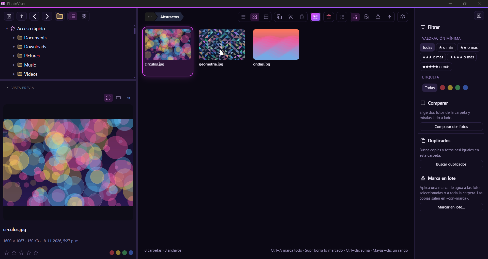
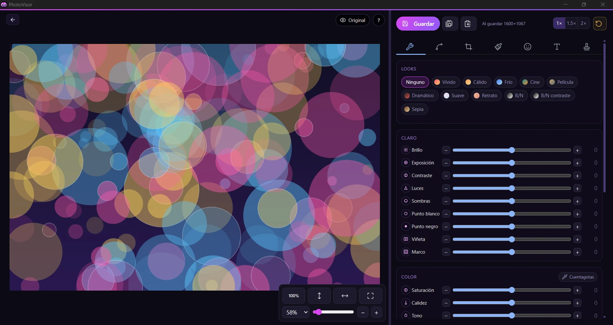
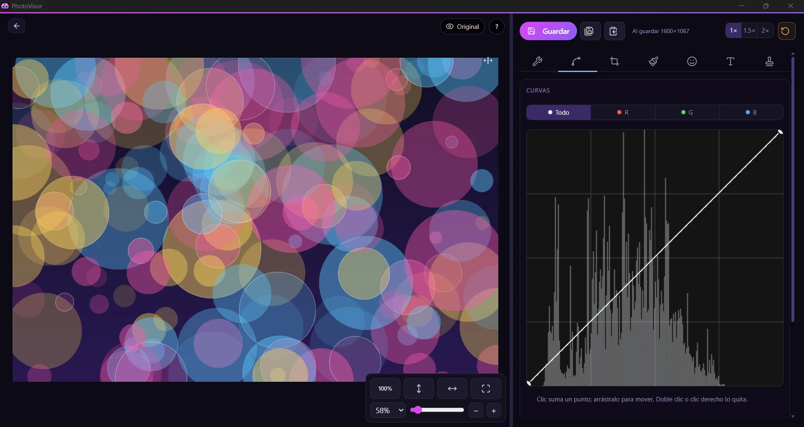
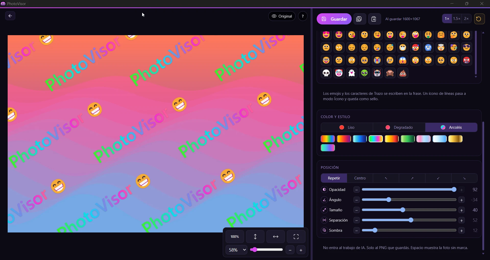
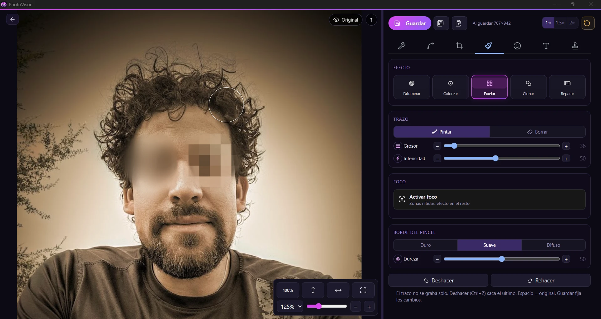

# PhotoVisor

Programa de Windows para mirar, ordenar y editar las fotos y videos de una carpeta. Todo queda en tu PC: sin cuenta y sin subir archivos.

Hecho con Tauri 2 (Rust y WebView2), React 19, TypeScript y Vite. El diseño original está en [`DISENO.md`](DISENO.md).

## Qué hace

### Explorador

- **Navegación:** árbol de carpetas con *Acceso rápido* y «Este equipo» (con los discos), ruta con migas en que se puede hacer clic (colapsa en «…» si no cabe), y los botones Subir, Atrás y Adelante (Alt + flechas).
- **Vistas:** lista, iconos medianos o iconos grandes (las carpetas crecen con las miniaturas). Orden por nombre, tipo o peso, ascendente o descendente.
- **Carpetas con información:** cada carpeta dice qué tiene («3 carpetas · 12 fotos y videos · 2 otros archivos») y las vacías se ven atenuadas. Muestra **todos** los archivos, no solo las fotos: los demás se abren con el programa de Windows (los ejecutables y scripts se bloquean).
- **Selección:** clic, Ctrl+clic, Mayús+clic para un rango, banda elástica, Ctrl+A y «seleccionar por tipo».
- **Acciones:** copiar, cortar y pegar (Ctrl+C, X, V), renombrar con doble clic en el nombre, papelera con Supr (con aviso si la carpeta tiene contenido) y borrado directo con Mayús+Supr. Girar y voltear una o varias fotos a la vez (Ctrl + flechas).
- **Valoración y etiquetas:** de 1 a 5 estrellas y cuatro colores de etiqueta, con filtro por valoración mínima y por etiqueta.
- **Vista previa** de lo seleccionado (ajustada, 1:1 o a todo el ancho) y panel de herramientas lateral que se contrae.
- **Recuerda** la distribución de los paneles, el tamaño y la posición de la ventana y la última carpeta.
- **Formatos de foto:** JPG, PNG, GIF, WebP, BMP, TIFF, AVIF, ICO, EXR, HDR, QOI, TGA y PNM. **Videos:** MP4, WebM, MOV, MKV, AVI y M4V (se reproducen, no se editan).

### Visor

- Foto o video a pantalla completa, con flechas para pasar al anterior o al siguiente.
- Zoom, ajustar a la ventana, mantener la relación o tamaño normal.
- **Editar** (E) y **Eliminar** directamente desde el visor.
- Doble clic en la foto grande vuelve a la carpeta; Esc también.

### Editor

Se abre desde el visor y trabaja sobre una foto. Las pestañas son: **Ajustar**, **Curvas**, **Posición**, **Pincel**, **Íconos**, **Texto**, **Marca de agua** y, si hay ComfyUI, **IA**.

**Ajustar**
- **Looks** de un clic, con intensidad regulable: Vívido, Cálido, Frío, Cine, Película, Dramático, Suave, Retrato, B/N, B/N contraste y Sepia.
- **Luz:** brillo, exposición, contraste, luces, sombras, punto blanco, punto negro, viñeta y marco (que puede ser negro o blanco).
- **Color:** saturación, calidez, tono, tono de piel, tono azul y **cuentagotas** de balance de blancos.
- **Detalle:** detalle, nitidez, ruido, ruido de color, grano de película y tamaño del grano.
- **Color por tono:** ocho tonos (rojo, naranja, amarillo, verde, aguamarina, azul, morado y magenta), cada uno con tono, saturación y luminosidad.

**Curvas y niveles**
- Curva de toda la luz o de cada canal (R, G y B) sobre el histograma de la foto. Clic suma un punto, arrastrar lo mueve, doble clic o clic derecho lo quita.
- Niveles: negro, medios, blanco y salida, con un botón **Auto** que ajusta a los extremos reales de la foto.

**Posición**
- **Recorte** libre o con proporciones (original, 1:1, 4:5, 3:2, 4:3, 16:9 y sus versiones verticales).
- Girar de a 90°, voltear y **enderezar** con un control fino (con sugerencia automática del ángulo).

**Pincel**
- **Difuminar:** suaviza solo lo pintado, por ejemplo para ocultar una cara o una patente.
- **Pixelar:** agrupa en bloques la zona pintada.
- **Colorear:** pinta un color sobre la zona (con 6 colores rápidos o uno a elección).
- **Clonar:** copia textura desde un origen que se fija con Mayús+clic.
- **Reparar:** quita manchas, polvo o marcas rellenando con la textura de alrededor.
- **Pintar y Borrar** (la goma saca lo aplicado), grosor hasta la mitad del lado mayor de la foto, intensidad y borde (duro, suave o difuso) con su dureza. Atajos: `[` y `]` para el grosor, `E`, `B` y `P`.
- **Foco:** deja zonas nítidas (círculos o elipses, uno o varios) y aplica el efecto en el resto, o al revés. Se pueden mover, cambiar de tamaño con el borde y quitar con clic derecho; con borde suave regulable, tamaño global, y presets de **Viñeta**, **Retrato** y **Miniatura** (efecto tilt-shift). Enter aplica y Esc limpia.
- Deshacer y rehacer (hasta 16 pasos del pincel); mantener Espacio muestra la foto original.

**Íconos**
- Casi 300 emojis a color (Fluent Emoji Flat), más de 200 íconos de trazo (Lucide), caracteres y líneas.
- **Color y estilo:** liso, degradado o arcoíris (con varias paletas multicolor), tamaño y giro.
- Se arrastran, se giran y se redimensionan sobre la foto; cada pieza se edita por separado.

**Texto**
- Cualquier fuente instalada en el equipo, con color y estilo liso, degradado o arcoíris, tamaño y giro.
- Los emojis se escriben dentro del texto como cualquier letra.

**Marca de agua**
- De texto, de ícono o de imagen. Se repite en diagonal, va al centro o a una esquina.
- Opacidad, ángulo, tamaño, separación y sombra; mismos colores y estilos que el texto.
- La misma marca se puede aplicar **en lote** (ver más abajo).

**IA (opcional, con ComfyUI instalado aparte)**
- Reemplazar o rellenar una zona, difuminar o poner fondo sólido, ampliar y convertir a estilos artísticos. Sin ComfyUI, todo lo demás funciona igual.

**Guardar**
- **Guardar** reemplaza el original, **Guardar copia** crea otro archivo y también se puede copiar al portapapeles.
- Formatos: PNG, JPEG, WebP y AVIF, con la calidad que se defina en Configuración. Escala de salida 1×, 1,5× o 2×.
- El editor muestra el tamaño final antes de guardar.

### Herramientas

- **Comparar** dos fotos lado a lado.
- **Duplicados:** asistente por grupos que encuentra copias exactas y fotos casi iguales; tiene en cuenta los nombres con «(N)» o «copia», y en Configuración se elige qué tan parecidas deben ser (casi idénticas, normal, amplio o muy amplio).
- **Marca de agua en lote** sobre una selección o una carpeta entera (con subcarpetas): deja las copias en una carpeta aparte y no toca los originales.
- **Datos EXIF** legibles (cámara, lente, fecha, exposición, apertura, ISO, distancia focal y ubicación) y un botón para **quitar el GPS**: borra las coordenadas del archivo sin cambiar la foto.
- **Configuración:** apariencia, duplicados, calidad al guardar y confirmaciones.

## Capturas

Las imágenes de las capturas son dibujos propios (ver `docs/muestras/`).

| | |
|---|---|
|  |  |
| **Explorador:** árbol, miniaturas, vista previa y panel de herramientas | **Editor:** looks, luz, color y detalle |
|  |  |
| **Curvas** por canal, con el histograma de la foto de fondo | **Marca de agua** con texto, emojis de color y arcoíris |
|  | |
| **Pincel:** difuminar, pixelar, colorear, clonar y reparar, con Foco | |

## Desarrollo

Requisitos: Node 22+ y, para compilar el programa, Rust (stable) con las herramientas de Tauri para Windows.

```powershell
npm install
npm run tauri dev      # ventana de desarrollo con recarga en caliente
```

Solo una ventana de PhotoVisor puede estar abierta a la vez (instancia única): cierra la instalada antes de abrir la de desarrollo.

| Comando | Para qué |
|---|---|
| `npm run typecheck` | Revisa los tipos de TypeScript |
| `npm test` | Pruebas de la lógica del editor (Vitest) |
| `cargo test --manifest-path src-tauri/Cargo.toml` | Pruebas del núcleo en Rust |
| `npm run tauri build` | Genera el instalador (lento: compila en modo release) |

Cada cambio a una rama pasa por la integración continua (`.github/workflows/ci.yml`): tipos, pruebas y build de la interfaz, y pruebas de Rust.

## Estructura

```
src/                     Interfaz (React)
  App.tsx                Explorador y visor
  editor/
    Editor.tsx           Componente principal del editor (estado y orquestación)
    EditorUi.tsx         Tarjetas y controles del panel (Card, OptRow, SliderRow…)
    EditorGlyphs.tsx     Íconos de las herramientas
    StickerUi.tsx        Paletas de íconos y emojis, color y estilo
    WatermarkDesigner.tsx Diseñador de marca de agua (editor y lote)
    editorGeometry.ts    Recorte, orientación y rasterizado
    editorAdjust.ts      Ajustes de luz, color y detalle (filtros por píxel)
    editorPaint.ts       Pincel: difuminar, pixelar, colorear, reparar
    editorFocus.ts       Foco: zonas, hit-test y máscara (lógica pura)
    editorMark.ts        Textos, íconos y marca de agua sobre la foto
    __tests__/           Pruebas
src-tauri/src/           Núcleo en Rust: archivos, miniaturas, catálogo, códecs, EXIF, duplicados
```

## Datos y privacidad

Las preferencias de la interfaz se guardan en el almacenamiento local del navegador embebido (distinto entre el programa instalado y el modo desarrollo). La configuración del programa vive en el perfil del usuario, fuera de las fotos.

## Licencias de terceros

Emojis: Fluent Emoji Flat (Microsoft, MIT), ver `src/editor/FLUENT_LICENSE.txt`. Íconos: Lucide (ISC).
